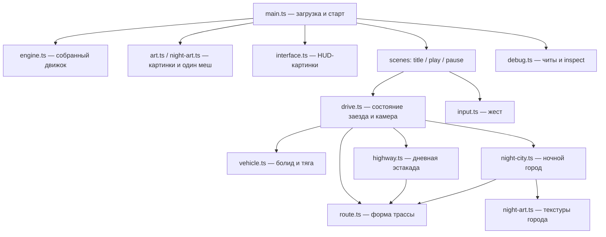

# Архитектура Speedster — общий отчёт

Это главный документ. Рядом лежат отдельные файлы по каждому исходнику `game/`:
`main.md`, `engine.md`, `art.md`, `route.md`, `drive.md`, `vehicle.md`, `highway.md`,
`night-art.md`, `night-city.md`, `interface.md`, `input.md`, `debug.md`,
`scenes-title.md`, `scenes-play.md`, `scenes-pause.md` и документы по данным:
`manifest.md`, `manifest-lock.md`, `assets-json.md`, `tsconfig.md`, `kestrel-glb.md`,
`game-readme.md`, `notes.md`.

---

## 1. Что это за игра

Speedster — вертикальный (720×1280) свободный заезд на антигравитационном болиде.
Игрок одним пальцем/мышью смещает болид влево-вправо по дороге, скорость растёт
автоматически до крейсерской и дальше держится. Есть счётчик дистанции, пауза и два
набора декораций:

| Карта | Геометрия | Как устроена «бесконечность» |
|---|---|---|
| `day` | прямая эстакада в мировых координатах | 13 секций по 24 м переезжают по Z |
| `night` | изогнутая улица неонового города | 13 слотов + «плавающее начало координат» |

Переключение карты — чит-код `map` (см. `debug.md`), по умолчанию `night`.
Столкновений, трафика и правил пока нет: это чистая проверка ощущения скорости и
точности управления (ТЗ — `docs/prototype-spec.md`).

---

## 2. Слои приложения



Правило, которое держит всю картину: **игровой код ничего не рисует сам**. Он меняет
поля объектов (`x`, `y`, `z`, `yaw`, `sx`, `tint`, `visible`, `frame`). Движок каждый
кадр обходит ростер объектов сцены, собирает из них таблицы инстансов и рисует.
Поэтому «анимация» в этом проекте — это арифметика в `game.step`, а не вызовы
отрисовки.

**Классов в игровом коде нет.** Это осознанный стиль: каждый модуль — набор функций и
замыканий, состояние — плоские объекты (`run`, `slot`, `piece`), «фабрика» — функция,
которая возвращает функцию обновления (`openRoad()`, `spawnVehicle()`,
`buildNightCity()`, `dragReader()`). Классы есть только внутри движка (`Camera`,
`Roster`, `Clock`… в `phaser/engine/kernel/src`), игры они не касаются.

---

## 3. Загрузка игры: `main.ts` по шагам

```ts
makeArt();            // меш 'jet' + картинка неба 'daylight'
prepareNightArt();    // 25 картинок ночного города
prepareInterface();   // 6 картинок HUD
await Promise.all([
    game.assets.load(assets, { pack: 'title' }),          // assets.json (сейчас пустой)
    game.modelFiles.load('kestrel', 'assets/kestrel.glb') // модель болида
]);
game.scenes.register(Title);
game.scenes.register(Play);
game.scenes.register(Pause);
addDebugControls();   // читы и inspect — до старта, работают с любого экрана
await game.start();
game.scenes.go('title');
```

Порядок важен: картинки и модель должны быть готовы **до** первого `enter()` сцены,
потому что `enter` сразу спавнит объекты, которые на них ссылаются (`texture`,
`model: 'kestrel'`).

---

## 4. Жизненный цикл сцены и кадра

- `game.scenes.register(scene)` — объект `{ name, enter() }`.
- `go(name)` заменяет весь стек и **удаляет всё, что сцена создала**: меши, модели,
  свет, текст, фоны, шаги, таймеры, твины, правила коллизий. Поэтому `go('play')`
  повторно — это чистый рестарт.
- `push('pause')` кладёт сцену поверх: нижняя замирает, её `game.step` не идёт;
  `pop()` возвращает её как есть (позиция болида сохраняется).
- `game.step('имя', cb)` — фиксированный шаг, принадлежащий сцене. В проекте по
  одному шагу на сцену: `grid` (титул), `drive` (заезд), `pause`.
- Порядок кадра: **шаги → сборка (gather) → фоны → меши 3D → HUD**. Камера и свет
  между сценами не сбрасываются — их задаёт `openRoad()` и билдеры карт.

Важная деталь движка: между фиксированными шагами рендер **интерполирует**
трансформы (чтобы картинка была плавной при любом шаге симуляции). Поэтому когда
объект не двигают, а «переставляют» на новое место (переиспользованная секция
дороги), нужно вызвать `obj.snap()` — он делает предыдущий трансформ равным
текущему и отключает интерполяцию на этот кадр. В проекте `snap()` вызывается ровно
в двух таких местах: `highway.ts` и `night-city.ts`.

---

## 5. Мир и камера

Единицы — метры. `y` вверх, `x` вправо, `z` — навстречу камере. Болид стоит почти в
начале координат, дорога уходит в −Z, камера висит в +Z и смотрит в −Z.

Камера — `rig-orbit` (включён в `core-3d` с `drag:false`, `zoomSpeed:0`). Значения из
`drive.ts`:

| Параметр | Значение | Что это значит |
|---|---|---|
| `CAMERA_DISTANCE` | 20.5 м | на сколько отъехать от точки взгляда |
| `CAMERA_PITCH` | 0.215 рад ≈ 12.3° | наклон вниз |
| `LOOK_AHEAD` | 9.1 м | точка взгляда впереди болида по Z |
| `yaw` | π | смотреть в −Z |
| `focus` | `(cameraX, 1, −9.1)` | куда смотрит камера |
| `CAMERA_LAG` | 10 (1/с) | скорость экспоненциального сближения с целью |
| `cameraX` | `0.91 · run.x` | камера проходит только 91 % смещения (9 % параллакса) |
| кламп | `±1.45 м` от болида | болид не вылетает из кадра при резком жесте |

Из этих чисел глаз камеры получается примерно `y ≈ 1 + 20.5·sin(0.215) ≈ 5.4`,
`z ≈ −9.1 + 20.5·cos(0.215) ≈ +10.9`.

Для ночной карты добавляется упреждение поворота:
`yaw = π + heading(distance + 9.1) − heading(distance)` — камера заранее
доворачивается в ту сторону, куда уйдёт трасса, а не догоняет её.

HUD живёт в отдельных пиксельных координатах (`game.screen.width/height` = 720×1280),
поверх 3D. Текст, картинки и кнопки — это отдельный «слой экрана», а не мировые
объекты.

---

## 6. Откуда берутся меши

В проекте четыре независимых источника геометрии и один источник внешнего вида.

| # | Источник | Где в проекте | Что это |
|---|---|---|---|
| 1 | Встроенные примитивы `geometry-3d` | `highway.ts`, `night-city.ts`, `vehicle.ts` | `spawn({ mesh: 'box' })`, `'cylinder'`, `'icosahedron'`. Примитив размером 1×1×1, растягивается через `size`/`sx..sz` |
| 2 | Свой «суп треугольников» через `game.world3d.defineMesh` | `art.ts` → `jet`; `night-city.ts` → `night-deck{n}`, `night-paving{n}`, `night-curb{n}` | массив `Float32Array`, 8 чисел на вершину: `x y z nx ny nz u v` |
| 3 | Файл модели `model-files-3d` | `assets/kestrel.glb` | `.glb` читается один раз, вписывается в единичный куб, `spawn` копирует инстансы. `size` = самый большой габарит в метрах |
| 4 | Нарисованные картинки `game.paint` | `art.ts`, `night-art.ts`, `interface.ts` | это не геометрия, а атлас: `texture`/`frame` на меше или `texture` на спрайте HUD |
| — | Свет и туман | `highway.ts`, `night-city.ts` | `render3d.lighting` — не меш, но определяет, как меши читаются |

### 6.1 Свой меш (`defineMesh`)

Формат вершин — **8 float на вершину**: позиция (3), нормаль (3), UV (2).
Треугольники не индексированы: каждая тройка вершин — отдельный треугольник, поэтому
у каждой вершины своя нормаль (плоские грани читаются как грани).

`defineMesh(имя, verts)` регистрирует меш глобально. **Повторный вызов с тем же
именем не создаёт новый меш, а заменяет вершины на месте** — все объекты, которые
его носят, меняются в том же кадре. Именно на этом построена ночная дорога: у каждого
слота свой меш `night-deck0…night-deck12`, и при переиспользовании секции вершины
пересчитываются, а объект остаётся тем же.

Вершины задаются в мировых единицах, объект спавнится с масштабом 1. Куллинг
считается по сфере вокруг начала координат меша, поэтому меш стоит авторить вокруг
своего нуля (так и сделано в `ribbon()`: вершины — относительно центра секции).

### 6.2 Модель из файла (`kestrel.glb`)

`game.modelFiles.load('kestrel', 'assets/kestrel.glb')` один раз; дальше
`game.modelFiles.spawn('kestrel', { id: 'craft', size: 4.13, y: HOVER })`.
Модель вписывается в единичный куб **вокруг центра**, поэтому `y` — это центр
модели, а не её низ. `size: 4.13` — длина болида в метрах по самой большой оси.
`HOVER = 0.58` подобрано так, чтобы низ корпуса висел чуть выше полотна.

---

## 7. Как объект попадает на экран

`game.spawn(spec)` — единственный способ создать мировой объект. Поля, которые
реально использует проект:

| Поле | Смысл |
|---|---|
| `id` | уникальное имя; у переиспользуемых объектов — `night-{слот}-{деталь}-{n}` |
| `mesh` | имя примитива или зарегистрированного меша |
| `model` | имя загруженной модели (альтернатива `mesh`) |
| `x, y, z` | **центр** объекта |
| `size` | число или `[w,h,d]`; записывается в `sx/sy/sz` один раз при спавне |
| `sx, sy, sz` | размеры по осям; проект часто задаёт их напрямую (дешевле, чем `size`) |
| `yaw, pitch, roll` | повороты в радианах; `roll` — крен болида |
| `color` / `tint` | цвет; это **один и тот же сеттер** (`color` — алиас `tint`) |
| `texture` + `frame` | картинка из атласа; `frame` здесь — **глобальный** индекс кадра |
| `unlit` | рисовать без освещения (неон, огни, тени) |
| `alpha` | прозрачность |
| `rough`, `metallic`, `emissive` | PBR-материал |
| `layer: 'hud'` | для спрайтов HUD вместо мирового слоя |
| `visible` | показывать/скрывать (условные детали города) |

Три тонкости, которые важно помнить:

1. `size` применяется только при спавне. Переиспользуя объект, пишите `sx/sy/sz`,
   иначе объект сохранит старый размер.
2. `unlit` тоже задаётся только при спавне. В ночном городе это безопасно, потому
   что порядок вызовов `place()` постоянен и одна и та же деталь всегда получает
   либо текстуру, либо нет.
3. `obj.snap()` — «телепорт»: сказать рендеру не интерполировать.

---

## 8. Два способа сделать бесконечную трассу

### 8.1 День (`highway.ts`) — мир неподвижен, секции едут по Z

1. В `enter()` один раз строятся 13 секций (`SECTION_COUNT`), каждая — массив
   коробок с локальным смещением `offset` по Z.
2. Каждый шаг: `travel = distance % 312`, и для каждой секции
   `z = 24 − ((i·24 − travel + 312) % 312)`.
3. Секции выстраиваются от `z = +24` (сзади камеры) до `z ≈ −264` (впереди).
4. Если `|mesh.z − z| > 24`, значит секция «перескочила» с конца в начало —
   вызывается `snap()`, иначе она бы проехала через весь экран интерполяцией.

Ключевое: **ничего не создаётся и не удаляется в рантайме**, меняется только `z`.

### 8.2 Ночь (`night-city.ts`) — плавающее начало координат

Ночная трасса изогнута, поэтому ехать по фиксированным Z нельзя. Здесь наоборот:
машина стоит на месте, а весь город каждый кадр пересчитывается в её систему
координат.

1. В `enter()` создаётся пул из 13 слотов: `{ logical: NaN, used: 0, pieces: [] }`.
2. Каждый кадр для `distance` берётся `here = routeAt(distance)`.
3. `first = floor(distance / 24) − 1` — первая «логическая» секция пула (одна назад
   для запаса).
4. Для `j = 0..12`: `logical = first + j`, `index = logical mod 13`, `slot = pool[index]`.
5. Если `slot.logical !== logical` — слот переодевается: пересчитываются вершины
   дороги и заново расставляются все детали (объекты **переиспользуются**).
6. Затем каждая деталь переводится из координат трассы в координаты машины:
   `obj.x = dx·cos + dz·sin`, `obj.z = −dx·sin + dz·cos`, `obj.yaw −= here.heading`,
   и после переодевания — `snap()`.

Итого: 13 слотов × ~35 деталей ≈ 455 объектов на весь город, созданных один раз.
Координаты всегда маленькие — точность float не деградирует на длинной дистанции.

### 8.3 Сравнение

| | День | Ночь |
|---|---|---|
| Форма трассы | прямая | изогнутая (`route.ts`) |
| Что двигается | секции по Z | всё, кроме машины |
| Система координат | мировая | локальная для машины |
| Переиспользование | смена `z` | смена `logical` + пересчёт меша |
| Нужен `snap()` | да, при переходе через 312 м | да, после переодевания слота |
| Сколько объектов | ~13 × 25 | ~455 |

---

## 9. Ночной город по шагам (самое сложное место проекта)

### 9.1 `route.ts` — форма дороги

Трасса — повторяющийся отрезок `PERIOD = 408 м`: правый поворот на 96 м, левый на
112 м, между ними плавные переходы (`BLEND = 24 м`). Интегрируется **один раз** при
загрузке модуля с шагом 1 м, поэтому `routeAt(d)` — это интерполяция готовой
таблицы, а не решение дифференциального уравнения на каждом кадре.

`routeAt(d)` возвращает `{ x, z, heading, sin, cos }`. `heading` — угол в радианах:
0 — на −Z, положительный — вправо. `sin/cos` — единичный вектор «вправо», на него
умножается боковое смещение деталей города.

### 9.2 `ribbon()` — полотно, тротуары и бордюры

Для секции берутся 7 сэмплов через 4 м (`SECTION/STEP + 1 = 7`). Из них строятся
три меша:

| Меш | Полосы | Что это |
|---|---|---|
| `night-deck{n}` | `−6…+6`, y=0 | асфальт с мокрыми отражениями |
| `night-paving{n}` | `−8.8…−6` и `+6…+8.8`, y=0.15 | тротуары |
| `night-curb{n}` | вертикальные полосы на кромках | бордюры |

`strip()` создаёт по 2 треугольника на каждый шаг между сэмплами. UV: `u` — поперёк,
`v` — вдоль секции (0…1), то есть **одна текстура ровно на 24 м**. Поэтому число
пунктиров и плиток заложено в саму картинку (`night-art.ts`), а не повторяется
тайлингом.

Вершины пишутся в абсолютных координатах трассы минус центр секции. Поэтому у
дорожных мешей `yaw` принудительно 0: поворот уже «запечён» в вершинах.

### 9.3 `dress()` — что стоит вдоль дороги

Порядок вызовов `place()` строго постоянен, и это инвариант: объекты
переиспользуются по индексу (`slot.pieces[i]`), поэтому 12-й вызов `place` в любой
секции должен означать одну и ту же деталь. Сейчас на секцию:

| # | Деталь | Смещение вдоль | Поперёк | Что задаёт |
|---|---|---|---|---|
| 0–2 | `deck`, `paving`, `curb` | 0 | 0 | дорожные меши |
| — | на каждую сторону (±1) — 15 деталей | | | |
| | `shop-block` | 0 | за тротуаром | витрина 4.24 м высотой, 20.8 м длиной |
| | `canopy` + `fascia` | 0 | у тротуара | навес и неоновая кромка |
| | `tower` | 0 | с отступом | башня 10…40 м с текстурой окон |
| | `penthouse` | −0.8 | сзади | надстройка 4 м |
| | `cornice` | 0 | — | карниз |
| | `mast` | −0.8 | — | антенна, видна при `seed % 3 === 0` |
| | `sign-bracket` + `marquee` | 0 | у фасада | вывеска, торчащая к камере |
| | `duct` | −6 | — | вентиляция, при `frontage === 1` |
| | `entry-lamp` | −5.5 | — | вход, при `frontage === 2` |
| | `door-light` | +4.8 | — | тёплая полоска над дверью |
| | `rear-tower` | −4 | 28…36 м | второй ряд башен |
| | `distant-tower` | +4 | 48…60 м | третий ряд |
| | `rear-block` | 0 | 39 м | тёмная плита, скрывающая пустоту |
| 33 | `skybridge` | 0 | 0 | мост через дорогу, при `logical % 9 === 4` |
| 34 | `bridge-strip` | 0.01 | 0 | светящаяся полоса под мостом |

Все «случайности» — детерминированный хэш `mix(logical, side)`: одна и та же
секция всегда выглядит одинаково, но соседние отличаются.

### 9.4 Производительность

- `ribbon()` вызывается только при переодевании слота (раз в 24 м), а не каждый кадр.
- Пул из 13 слотов даёт ~455 объектов — постоянное число на любом пробеге.
- Каждый кадр на объект приходится ~6 умножений и 3 записи полей.

---

## 10. HUD и ввод

`interface.ts` рисует 6 картинок (заголовок, три кнопки, подсказка, телеметрия,
кнопка паузы, заголовок паузы) через `game.paint`, запоминает размеры в `Map` и
выдаёт их как спрайты слоя `hud` функцией `showGraphic(key, x, y)`. Кнопка — это
`showGraphic` (видимая картинка) + прозрачный `game.ui.button` (ввод), потому что
виджет UI отвечает за попадание пальцем, фокус, клавиатуру и геймпад.

`input.ts` — `dragReader()`: относительный жест. Каждое нажатие запоминает свою
стартовую точку, `dx` считается от предыдущего кадра, вертикаль игнорируется. Смысл
в том, что касание в любом месте экрана **не прыгает** болид, а продолжает движение
с текущей позиции.

---

## 11. Сводная таблица коэффициентов

### Управление и движение (`drive.ts`)

| Константа | Значение | Комментарий |
|---|---|---|
| `CRUISE` | 40 м/с | 144 км/ч |
| `ACCEL_TIME` | 2 с | разгон идёт с 20 м/с² |
| `MAX_X` | 5 м | `(12 − 2)/2`: корпус 2 м остаётся над полотном |
| чувствительность | `dx · 10 / 360` м | 360 px (полэкрана) = вся ширина дороги |
| `CAMERA_DISTANCE` | 20.5 м | |
| `CAMERA_PITCH` | 0.215 рад | |
| `LOOK_AHEAD` | 9.1 м | |
| `CAMERA_LAG` | 10 1/с | |
| `cameraX` доля | 0.91 | параллакс |

### Болид (`vehicle.ts`)

| Константа | Значение | Комментарий |
|---|---|---|
| `CRAFT_WIDTH` | 2 м | используется для `MAX_X` |
| `HOVER` | 0.58 м | высота центра модели |
| `BANK_LIMIT` | 0.19 рад ≈ 10.9° | максимальный крен |
| парение | `sin(t·3.2)·0.035 м` | ±3.5 см |
| сглаживание крена | 13 1/с | |
| цель крена | `−clamp(lateralSpeed/9)·0.19` | |
| длина факела | `0.09 + throttle·(0.86 + 0.08·sin(t·32))` | |
| факел-ядро | 0.66 от длины | |
| тень | `1.98 × 0.008 × 3.25`, alpha 0.62 ночь / 0.25 день | |

### Трасса (`route.ts`, `highway.ts`, `night-city.ts`)

| Константа | Значение | Комментарий |
|---|---|---|
| `PERIOD` | 408 м | период повторов формы |
| `RIGHT_ENTRY` / `LEFT_ENTRY` | 96 / 224 м | где начинаются повороты |
| `BLEND` | 24 м | длина входа в поворот |
| `TURN` | 0.36 рад ≈ 20.6° | суммарный поворот каждой дуги |
| `SECTION` | 24 м | длина секции |
| `SECTION_COUNT` | 13 | секций/слотов в пуле |
| `CIRCUIT_LENGTH` | 312 м | 24 × 13 |
| `ROAD_WIDTH` | 12 м | |
| `WALK` / `CURB` | 2.8 / 0.15 м | тротуар и бордюр |
| `STEP` | 4 м | шаг сэмплирования полотна |

### Свет (`highway.ts` / `night-city.ts`)

| | День | Ночь |
|---|---|---|
| пресет | `noon` | `night` |
| `sunIntensity` | 1.1 | 0.96 |
| `ambient` | 0.66 | 0.5 |
| `fogStart` / `fogEnd` | 54 / 210 | 150 / 320 |
| тени | выключены | включены |
| `environment` | 0.32 | 0.32 |

---

## 12. Карта файлов

| Файл | Роль | Экспорты | Документ |
|---|---|---|---|
| `main.ts` | загрузка, регистрация сцен, старт | — | [main.md](main.md) |
| `engine.ts` | **сгенерированный** объект `game` из паков | `game`, `composed`, `signals`, типы `Obj/Sprite/Mesh/Shape`, `sheet` | [engine.md](engine.md) |
| `art.ts` | меш `jet`, картинка дневного неба | `makeArt` | [art.md](art.md) |
| `route.ts` | форма трассы | `routeAt`, `RIGHT_ENTRY`, `LEFT_MIDDLE` | [route.md](route.md) |
| `drive.ts` | состояние заезда, ввод в боковое смещение, камера | `run`, `openRoad`, `advance`, `steer`, `seekDrive`, `selectMap`, `activeMap`, `CRUISE` | [drive.md](drive.md) |
| `vehicle.ts` | болид, крен, тяга, тень | `spawnVehicle`, `CRAFT_WIDTH` | [vehicle.md](vehicle.md) |
| `highway.ts` | дневная эстакада | `buildHighway`, `ROAD_WIDTH`, `SECTION`, `SECTION_COUNT`, `CIRCUIT_LENGTH` | [highway.md](highway.md) |
| `night-art.ts` | 25 процедурных картинок города | `prepareNightArt`, `NEON`, `NAMES`, `NIGHT_HAZE` | [night-art.md](night-art.md) |
| `night-city.ts` | ночной город и его переиспользование | `buildNightCity` | [night-city.md](night-city.md) |
| `interface.ts` | картинки HUD и зоны нажатия | `prepareInterface`, `showGraphic`, `control` | [interface.md](interface.md) |
| `input.ts` | относительный жест | `dragReader` | [input.md](input.md) |
| `debug.ts` | читы и `inspect` | `addDebugControls` | [debug.md](debug.md) |
| `scenes/Title.ts` | стартовый экран с живой дорогой | `Title` | [scenes-title.md](scenes-title.md) |
| `scenes/Play.ts` | заезд | `Play` | [scenes-play.md](scenes-play.md) |
| `scenes/Pause.ts` | пауза поверх заезда | `Pause` | [scenes-pause.md](scenes-pause.md) |
| `manifest.json` | экран, сид, список паков, ассеты | — | [manifest.md](manifest.md) |
| `manifest.lock.json` | зафиксированный граф паков и хэши | — | [manifest-lock.md](manifest-lock.md) |
| `assets.json` | ключи загружаемых файлов | — | [assets-json.md](assets-json.md) |
| `tsconfig.json` | настройки TypeScript игры | — | [tsconfig.md](tsconfig.md) |
| `assets/kestrel.glb` | модель болида | — | [kestrel-glb.md](kestrel-glb.md) |
| `README.md` | краткая справка по запуску | — | [game-readme.md](game-readme.md) |
| `NOTES.md` | как проверять и карта кода (устаревает) | — | [notes.md](notes.md) |

Папки `game/` вне списка:

- `docs/` — **справочник движка**, сгенерированный при сборке (пишется пекарней).
  Читать: `make-a-3d-game.md` (полный обзор API), `03-world-3d.md`, `11-render-3d.md`,
  `10-geometry-3d.md`, `13-maths.md`, `16-ui.md`, `00-kernel.md`.
- `play/` — служебные данные инструмента `play`: `session.json`, `events.jsonl`,
  папки скриншотов по проверкам (`acceptance/`, `final/`, `kestrel/`, `nightqa/`).
- `shots/` — сохранённые кадры из `play` (номер + метка проверки).
- `dist/` — результат сборки (в репозитории может отсутствовать).

---

## 13. Слабые места и на что смотреть при правках

1. **Порядок `place()` в `dress()` — контракт.** Объекты переиспользуются по
   индексу. Если добавить деталь в одну ветку (например, только для `frontage === 1`),
   все последующие индексы сдвинутся и детали «переедут». Добавляйте деталь для всех
   секций, а различие делайте через `visible`.
2. **`unlit` фиксируется при спавне.** Деталь должна всегда получать (или всегда не
   получать) текстуру.
3. **Туман против пула.** Ночью впереди стоит геометрия примерно на 288–312 м (зависит
   от положения внутри секции), а `fogEnd: 320`. Запас ~10–30 м: если уменьшить пул
   или отодвинуть туман, станет видна кромка города. Для дня запас большой (264 м
   геометрии против `fogEnd: 210`).
4. **`run.map`, `run.cycles`, `run.sections`** пишутся, но игровым кодом не читаются —
   они нужны `inspect` и читам. Это не ошибка, но помните про это при рефакторинге.
5. **`seekDrive()`** меняет только `distance`; мир переставится на следующем шаге
   `draw`, а `snap()` уберёт интерполяцию — поэтому чит-переход не «пролетает»
   сквозь город.
6. **Рестарт = перестройка.** `go('play')` вызывает `openRoad()` заново: город/эстакада
   строятся с нуля. Это дорого, но происходит только по кнопке.
7. **Дневная карта после ночной** использует те же `SECTION_COUNT` и `CIRCUIT_LENGTH`,
   но в мировых координатах; `run.x` и камера общие, поэтому переключение карты идёт
   только через `title` (чит `map` делает именно это).

---

## 14. Как проверять

```sh
node phaser/bin/bake.mjs build game dist      # или npm run -s build — типы + бандл
node phaser/bin/bake.mjs smoke game           # headless-прогон
node phaser/cli/bin/phaser-ae.mjs play "..."  # игра в браузере, время по команде
node phaser/cli/bin/phaser-ae.mjs serve       # живой предпросмотр :4173
node phaser/node_modules/typescript/bin/tsc -p game --noEmit
```

Читы для проверки дальней части трассы: `cheat checkpoint right|left|wrap|shop`,
`cheat longrun`, `cheat map day|night`.

---

## 15. Системные папки (`phaser/`) — очень коротко

| Путь | Что внутри |
|---|---|
| `phaser/bin/bake.mjs` | единственная точка сборки/проверки: `build`, `smoke`, `look`, `check`, `game` |
| `phaser/cli/bin/phaser-ae.mjs` | CLI Phaser AE: запускает подкоманды из `lib/` |
| `phaser/cli/lib/` | по файлу на команду: `serve`, `packs`, `publish`, `upload`, `changes`, `crew`, `tool`, `playtest`, `credits`, `gdd`, `idea`, `status`, `login`… |
| `phaser/engine/bakery/` | пекарня: читает `manifest.json`, разворачивает паки, пишет `game/engine.ts` и `game/docs/`. Шаблоны скелетов: `skeleton`, `skeleton-3d`, `skeleton-vector` |
| `phaser/engine/kernel/src/` | ядро движка: `game.impl.ts` (сборка `createGame`), `roster` (объекты и трансформы), `scene`, `render`, `camera`, `input`, `assets`, `clock`, `cheats`, `inspect`, `save`, `ui`-хуки |
| `phaser/engine/shared/` | общий код для инструментов (`command-replay.ts` — запись/воспроизведение команд) |
| `phaser/engine/vendor/` | сторонние нативные ядра: box2d, box3d, recast-navigation, шрифты. **В этой игре не используются** |
| `phaser/docs/reference/` | `CONVENTIONS.md` (правила кода движка), `FONTS.md` (каталог шрифтов) |
| `phaser/examples/` | примеры и пробы движка, шрифты |
| `phaser/node_modules/@phaser-ae/*` | установленные паки; у каждого `dist/` (JS), `types/` (d.ts), `docs/`, `schema.json` |
| `game/docs/` | сгенерированные страницы этих паков на человеческом языке |

Пак в этой игре — это не «плагин Phaser 3», а модуль, который при `use()` добавляет
поля в объект `game` (`game.world3d`, `game.render3d`, `game.ui`, `game.modelFiles`…).
`engine.ts` — буквально список `.use(...)`; добавить возможность = добавить пак в
`manifest.json` и перепечь.
